<!-- ═══════════════════════════ HERO BANNER ═══════════════════════════ -->

📍 Bengaluru, Karnataka, India &nbsp;·&nbsp;
💻 MERN Stack / Full-Stack Developer &nbsp;·&nbsp;
🎓 Computer Science Engineering Graduate

<!-- ═══════════════════════════ NAVIGATION ═══════════════════════════ -->

<!-- ═══════════════════════════ ABOUT ═══════════════════════════ -->

<h3 align="center">👨‍💻 About Me</h3>

<table width="100%">
<tr>
<td>

**MERN Stack Developer** with strong **Node.js** backend skills and hands-on experience building secure, scalable, real-time web applications.

Experienced in architecting Express.js REST APIs, JWT authentication, RBAC, Redis-backed rate limiting, Socket.io event-driven streaming, and relational & NoSQL database design (**MySQL, PostgreSQL, MongoDB**). Modernized a large legacy production codebase to **ES6+** and delivered a zero-downtime password migration from **SHA-1 to Argon2id** for an international client (**Topmai, Mexico**).

Strong foundation in Data Structures & Algorithms, Object-Oriented Programming, and System Design.

</td>
</tr>
</table>

<!-- ═══════════════════════════ WHAT I DO ═══════════════════════════ -->

<h3 align="center">🚀 What I Do</h3>

<table width="100%">
<tr>
<td>

- 🌐 Build end-to-end full-stack web applications using the **MERN & PERN Stacks** (**React 19, Next.js, Node.js, Express 5, MongoDB, PostgreSQL**)
- ⚡ Architect real-time communication systems with **Socket.io & WebSockets** for live messaging, presence tracking, and dynamic dashboards
- 🔐 Implement enterprise-grade security: **Argon2id password hashing, stateless JWT authentication, RBAC, and Redis rate limiting**
- 🔄 Modernize legacy production codebases into modular **ES6+ async/await** with clean architecture and standardized REST APIs
- 🗄️ Design high-performance database schemas with **PostgreSQL ACID transactions**, row-level locks, and **MongoDB** aggregation
- 📦 Engineer multi-part file and media upload pipelines using **Multer** and secure storage handlers
- ⚙️ Containerize and deploy services using **Docker, Git, GitHub**, and API testing with **Postman**
- 🧩 Solve complex computational problems through **Data Structures & Algorithms** and scalable **System Design**

</td>
</tr>
</table>

<!-- ═══════════════════════════ TECH STACK ═══════════════════════════ -->

<h3 align="center">🛠️ Tech Stack</h3>

<table width="100%">
<tr>
<td>

#### 💻 Languages

</td>
</tr>
<tr>
<td>

#### ⚙️ Backend & Real-Time

  

**Backend Specializations:**  
RESTful API Design · Real-Time Event Streaming · Zero-Downtime Migrations · Legacy ES6+ Modernization · SQL Optimization

</td>
</tr>
<tr>
<td>

#### 🎨 Frontend

</td>
</tr>
<tr>
<td>

#### 🗄️ Databases & Caching

  

**Database Concepts:**  
ACID Transactions · Row-Level Locking · Caching Strategies · Index Optimization · NoSQL Data Modeling

</td>
</tr>
<tr>
<td>

#### 🔐 Security & Authorization

  

**Security Practices:**  
Stateless JWT Authorization · Lazy Credential Rehashing · Role-Based Access Control · Redis-Based Rate Limiting

</td>
</tr>
<tr>
<td>

#### ☁️ DevOps & Tools

</td>
</tr>
</table>

<!-- ═══════════════════════════ CORE CONCEPTS ═══════════════════════════ -->

<h3 align="center">🧠 Core Concepts</h3>

<!-- ═══════════════════════════ EXPERIENCE ═══════════════════════════ -->

<h3 align="center">💼 Experience</h3>

<table width="100%">
<tr>
<td>

#### Backend Developer (Node.js) — SkyllX Technologies Pvt. Ltd.
**Jun 2026 – Present**  
*Client: Topmai, Mexico | Node.js, Express.js, MySQL, Redis, Socket.io, Sequelize, JWT, Argon2*

- ⚙️ **Legacy Codebase Modernization:** Modernized a large legacy Node.js/Express codebase by refactoring procedural, callback-based code into modular ES6+ async/await with standardized error handling and REST status codes.
- 🔐 **Zero-Downtime Credential Migration:** Designed a zero-downtime credential migration that dynamically re-hashed legacy SHA-1 passwords to Argon2id at login, with no service disruption and no forced password resets.
- 🛡️ **RBAC & Enhanced JWT Security:** Implemented Role-Based Access Control (RBAC) and strengthened JWT security with issuer/audience verification and Redis-backed rate limiting, while maintaining full backward compatibility for older mobile app versions.
- 💬 **Threaded Chat & International Delivery:** Built threaded message replies for direct and group chat using Sequelize with optimized SQL joins, encrypted payload handling, and real-time Socket.io events; collaborated directly with an international client team to resolve production issues and deliver business requirements.

</td>
</tr>
</table>

<!-- ═══════════════════════════ PROJECTS ═══════════════════════════ -->

<h3 align="center">🚀 Featured Projects</h3>

<table width="100%">
<tr>
<td>

#### 🗳️ Online Voting Platform

  

- Engineered a secure voting system with unique voter-ID verification and strict role separation between voters and administrators.
- Guaranteed one-person-one-vote integrity using PostgreSQL transactions, row-level locking, and unique constraints, preventing double voting and race conditions.
- Built live election dashboards with Socket.io streaming real-time vote counts, along with password recovery and token-based sessions.

 

🔗 [**View Repository**](https://github.com/maheshpujari0476/PERNbased-voting-application)

</td>
</tr>
</table>

 

<table width="100%">
<tr>
<td>

#### 💬 Real-Time Chat Platform (WhatsApp Web Clone)

  

- Built a type-safe, full-stack messaging application with instant message delivery, typing indicators, and user online/offline presence tracking using Socket.io.
- Secured authentication with Argon2 password hashing and stateless JWTs stored securely in HTTP-only cookies.
- Implemented file and media sharing pipelines using Multer and an optimized image-handling flow.

 

🔗 [**View Repository**](https://github.com/maheshpujari0476/MERNbased-Realtimechat-application)

</td>
</tr>
</table>

<!-- ═══════════════════════════ ARCHITECTURAL HIGHLIGHTS ═══════════════════════════ -->

<h3 align="center">🧩 Architectural Highlights</h3>

<table width="100%">
<tr>
<td>

#### 🔐 Zero-Downtime Credential Migration (SHA-1 ➔ Argon2id)

  

Architected a transparent lazy-rehashing mechanism on authentication endpoints. When active users log in with obsolete SHA-1 credentials, the system validates the hash, seamlessly generates a memory-hard Argon2id hash in the background, updates the database, and issues an upgraded JWT token—modernizing user security with zero downtime or user friction.

</td>
</tr>
</table>

 

<table width="100%">
<tr>
<td>

#### ⚡ Real-Time Bidirectional Event Streaming

  

Designed real-time event-driven backends using Socket.io and Redis pub/sub. Enabled sub-100ms bidirectional synchronization for instant 1:1 chat, group messages with threaded replies, user presence indicators, and live ballot count tallies across distributed client sessions.

</td>
</tr>
</table>

<!-- ═══════════════════════════ DSA ═══════════════════════════ -->

<h3 align="center">🧠 Data Structures & Algorithms</h3>

<table width="100%">
<tr>
<td>

I regularly practice problem-solving and focus on building strong computer science fundamentals.

**Topics:**

</td>
</tr>
</table>

<!-- ═══════════════════════════ CERTIFICATION ═══════════════════════════ -->

<h3 align="center">📜 Certification</h3>

<table width="100%">
<tr>
<td align="center">

🏅 **Software Engineer Certificate — HackerRank**

</td>
</tr>
</table>

<!-- ═══════════════════════════ GITHUB STATS ═══════════════════════════ -->

<h3 align="center">📊 GitHub Stats</h3>

<!-- ═══════════════════════════ FOCUS ═══════════════════════════ -->

<h3 align="center">🌱 Currently Focused On</h3>

<table width="100%">
<tr>
<td>

- 🚀 Advanced Node.js & Express Architecture (ES6+ & TypeScript)
- ⚡ Real-Time Systems & WebSocket Scaling with Socket.io & Redis
- 🧩 Data Structures & Algorithms
- 🏗️ High-Throughput System Design & Distributed Caching
- 🔐 Advanced Auth Patterns, Argon2id, and Fine-Grained RBAC
- 🗄️ Database Transactions, ACID Integrity, and Index Tuning
- 🐳 Production Deployments with Docker

</td>
</tr>
</table>

<!-- ═══════════════════════════ CAREER INTERESTS ═══════════════════════════ -->

<h3 align="center">🎯 Career Interests</h3>

<table width="100%">
<tr>
<td align="center">

💻 MERN Stack Development ·  
🌐 Full-Stack Web Engineering ·  
⚙️ Node.js & Express Backend Development ·  
⚡ Real-Time Event-Driven Systems ·  
🏗️ Scalable System Design ·  
🗄️ Database Engineering (PostgreSQL & MongoDB)

</td>
</tr>
</table>

<!-- ═══════════════════════════ CONNECT ═══════════════════════════ -->

<h3 align="center">📫 Connect With Me</h3>

 

<!-- ═══════════════════════════ FOOTER BANNER ═══════════════════════════ -->

